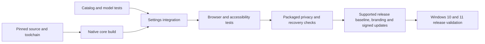

# Fastest maintainable delivery path

The critical path is a working upstream build followed by verified settings integration, packaged privacy/security checks, and fork-safe distribution. Adding another rendering engine, replacing upstream C++, building a separate settings framework, or growing an independent service stack would lengthen that path and increase rebase risk.

## Applied decisions

1. Maintain a small downstream patch repository against an exact Firefox commit instead of duplicating the full upstream tree in this repository. A full pinned checkout and native build live separately under `C:/lumen-work` on the development host.
2. Reuse Firefox's build system, sandbox, native preferences, accessibility, localization, extensions, profile mechanisms and existing tools. Add no new runtime framework or daemon.
3. Generate 57 controls, their localization resources and packaging from one typed catalog. Keep simple and advanced modes in the existing Settings page. Use a pure settings model for fast failure-injection tests without recompiling Gecko.
4. Compile the existing core while completing independent settings tests/documentation. Add frontend changes after that build, then use the upstream frontend rebuild path. Avoid restarting the full compiler for UI-only edits.
5. Run fast tooling/settings tests in Windows/Linux CI on each push/PR. CI does not certify a browser. Full browser, packaging, Windows 10 and privacy checks remain explicit separate gates.
6. Freeze discretionary feature additions until the current build and settings pass their gates. Fix measured usability, compatibility or reliability problems first.

## Remaining milestones

| Milestone | Exit condition |
|---|---|
| Development build | Completed on the Windows 11 host: native x64 compile, real settings/defaults tests, package creation and extracted ZIP startup. Full compatibility/privacy qualification remains separate |
| Product integration | Original Lumen Browser branding, separate application/install/profile identity, local first-launch controls and a per-user native installer are implemented; native/payload verification passes on the Windows 11 host; finish full accessibility qualification |
| Privacy and compatibility | Complete source-consumer inventory, packaged traffic evidence, security-preservation tests, extension/accessibility matrix, Windows 10 and Windows 11 execution |
| Release infrastructure | Supported security baseline, private reporting channel, release ownership, signed update identity/service and tested failure recovery |
| Release candidate | Every gate in VERIFICATION.md met; documentation, source provenance and notices match the exact artifact |

No completion date is asserted. Native build success cannot eliminate release infrastructure or test requirements. The current upstream main pin is an investigation/development baseline; the public release needs a supported security-maintained baseline and a fresh validation pass. Read [PRODUCT_GOALS.md](PRODUCT_GOALS.md) for the accepted product requirements and [ROADMAP.md](ROADMAP.md) for scope/status.

## Current shortest safe sequence

The native identity build, resource metadata correction, refreshed controls/defaults tests and final adapter benchmark are complete. Stable internal Lumen/lumen identifiers are preserved; exact ZIP/full installer postconditions pass on the Windows 11 host. Next prioritize packaged traffic/security and Windows 10 execution, then a supported baseline and signed update/recovery infrastructure. Those gates cannot be replaced by more customization controls.

## Release-baseline choice

The owner is being asked to choose ESR, Firefox Release, or continued investigation on the current development pin before any replacement is made. Mozilla describes ESR as annual feature releases with incremental security updates, while Release brings features more frequently ([channel comparison](https://firefox-admin-docs.mozilla.org/guides/firefox-channels/), checked 2026-10-18). The recommendation to consider ESR for steadier downstream maintenance is an engineering inference; initial porting effort has not been measured. Windows 10 remains the requested target, and Mozilla's own support statement does not substitute for Lumen execution ([upstream Windows 10 statement](https://support.mozilla.org/en-US/kb/firefox-support-windows-10-end-support)). No rebase is authorized by elapsed time or by the recommendation alone.
